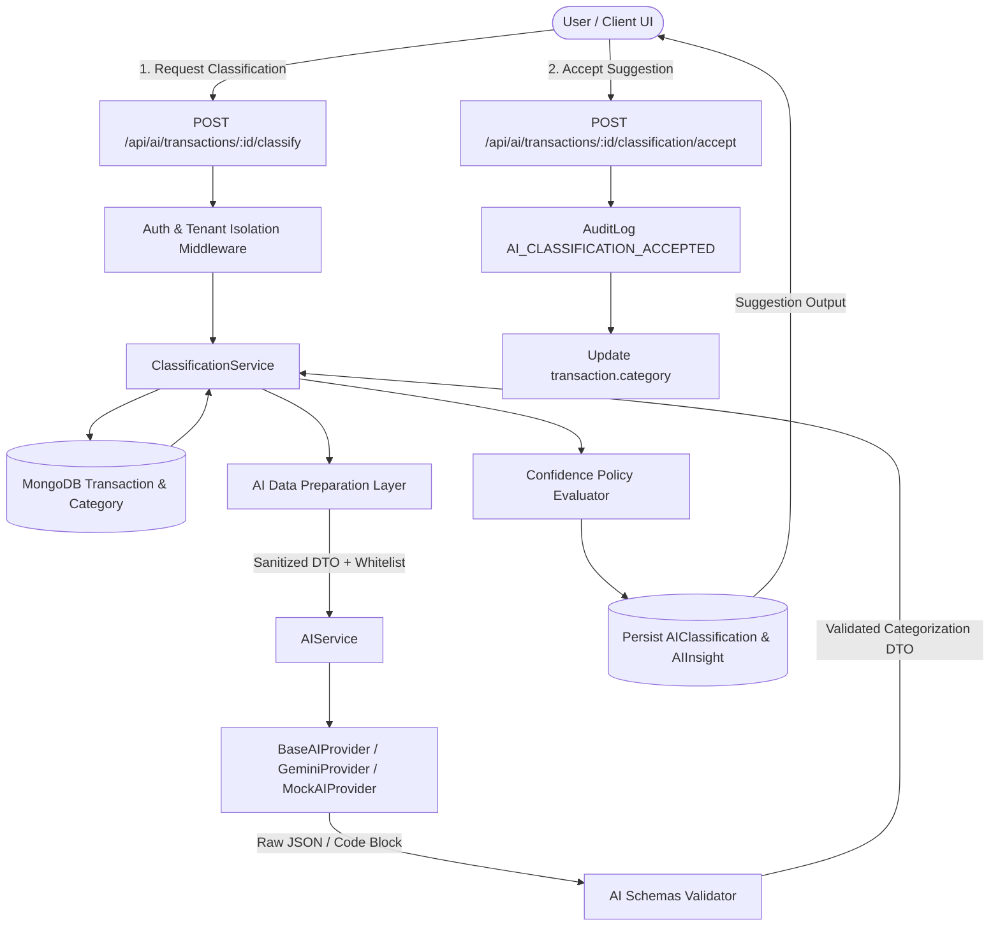

# SEIP AI Expense Categorization Architecture & Guide

## 1. Overview

The **AI Expense Categorization** feature is the first intelligent financial recommendation capability in the **Smart Expense Intelligence Platform (SEIP)**. It analyzes raw expense metadata (merchant/payee, amount, description, payment method, date) and recommends an authorized financial category with a confidence score and rationale.

### Strict Core Principle
> **The AI provides an advisory RECOMMENDATION.**  
> **The AI NEVER mutates financial ledger balances, transaction amounts, transaction types, or financial categories directly.**  
> **Financial categories are only modified upon explicit user confirmation (`/classification/accept`) or manual override (`PUT /api/transactions/:id`).**

---

## 2. Architecture & Request Flow



### Flow Breakdown
1. **Transaction Retrieval**: Transaction is loaded by ID strictly scoped to `req.organizationId` and caller permissions (IDOR protection).
2. **Category Whitelist Generation**: Category model is queried for active categories within the tenant (`scope: system`, `scope: organization` for tenant, `scope: user` for caller).
3. **Data Sanitization**: `prepareTransactionContext()` strips all MongoDB internals, passwords, tokens, hashes, and sensitive metadata.
4. **Structured Generation**: `AIService.classify()` prompts the AI model with strict instruction to choose only from the authorized categories.
5. **Output Validation**: `validateClassificationOutput()` cleans markdown fences, parses JSON, enforces confidence bounds (0.0 to 1.0), truncates reason lengths, and ensures the suggested category strictly exists in the authorized list.
6. **Persistence & Insights**: Saves `transaction.AIClassification` with status `SUGGESTED` (leaving `transaction.category` intact) and creates/updates a tenant-scoped `AIInsight` of type `EXPENSE_CLASSIFICATION`.
7. **User Decision**:
   - **Accept**: Calls `/classification/accept`, sets `transaction.category = suggestedCategory`, updates status to `ACCEPTED`, and logs audit trail.
   - **Reject**: Calls `/classification/reject`, keeps `transaction.category`, updates status to `REJECTED`, and logs audit trail.
   - **Manual Override**: User edits category directly via `PUT /api/transactions/:id`. Manual category takes strict precedence.

---

## 3. Data Preparation Layer

The AI data preparation layer (`backend/src/services/ai/dataPreparation/dataPreparation.js`) guarantees tenant boundaries and prevents data leakage:

- **Included Fields**:
  - `type` ("expense" or "income")
  - `amount` (numeric)
  - `currency` (ISO code, e.g. "INR")
  - `merchant` / `payee`
  - `description` (truncated to max 300 characters)
  - `date` (YYYY-MM-DD)
  - `allowedCategories` (canonical list of authorized categories)
- **Excluded Fields**:
  - Passwords and password hashes
  - JWT tokens and session identifiers
  - MongoDB internal keys (`__v`, `_id`, timestamps)
  - Cross-tenant data
  - Payment credentials or account numbers

---

## 4. Prompt & Schema Contract

### Model Prompt Template
```text
Classify this transaction into one of the allowed categories:
Type: expense
Amount: 450 INR
Merchant/Payee: "Swiggy"
Description: "Dinner order"
Date: 2026-10-06
Allowed Categories: [Food & Dining, Transport, Shopping, Bills & Utilities, Education, Healthcare, Entertainment, Salary & Wages, Business Revenue, Investment, Other / Misc]

Output strictly valid JSON with format:
{
  "suggestedCategory": "exact string from allowed categories",
  "confidence": number between 0.0 and 1.0,
  "reason": "short explanation"
}
```

### Strict Validation Rules
1. `suggestedCategory` (or `category`) must be a string and match one of the allowed categories (case-insensitive mapping to canonical name).
2. Any hallucinated category not in the whitelist (e.g. `"Luxury Food Delivery"`) causes an `AIValidationError` (HTTP 502) and sets transaction status to `FAILED`.
3. `confidence` must be a valid float between `0.0` and `1.0`.
4. `reason` is limited to 300 characters.

---

## 5. Confidence Policy

Confidence scoring is centralized in `backend/src/services/ai/classification/confidencePolicy.js`:

| Confidence Range | Tier | Status / Recommendation Flag | UI Presentation |
|---|---|---|---|
| `>= 0.85` | `HIGH` | Strong recommendation | Emerald badge, quick-accept button |
| `0.60 - 0.84` | `MEDIUM` | Moderate suggestion | Amber badge, review recommended |
| `< 0.60` | `LOW` | Weak suggestion | Blue badge, marked "Low confidence - review carefully" |

Low confidence suggestions remain suggestions only and cannot be automatically accepted.

---

## 6. Endpoints & API Contract

All endpoints are mounted under `/api/ai` and require `authenticateToken` and `tenantContext`.

### 1. Request Transaction Classification
`POST /api/ai/transactions/:transactionId/classify`
- Query/Body Parameters: `force=true` (optional, bypasses idempotency cache)
- Response:
```json
{
  "success": true,
  "data": {
    "transactionId": "6ac3faec...",
    "classification": {
      "suggestedCategory": "Food & Dining",
      "confidence": 0.96,
      "reason": "Food delivery transaction.",
      "provider": "gemini",
      "model": "gemini-1.5-pro",
      "status": "SUGGESTED",
      "classifiedAt": "2026-10-06T00:50:00.000Z"
    },
    "confidenceTier": "HIGH",
    "isStrongSuggestion": true,
    "currentCategory": "misc",
    "reused": false
  },
  "message": "Transaction classified successfully"
}
```

### 2. Accept Category Suggestion
`POST /api/ai/transactions/:transactionId/classification/accept`
- Updates `transaction.category = suggestedCategory`
- Updates status to `ACCEPTED`
- Emits `AuditLog` action `AI_CLASSIFICATION_ACCEPTED`
- Dismisses associated `AIInsight`

### 3. Reject Category Suggestion
`POST /api/ai/transactions/:transactionId/classification/reject`
- Body: `{ "reason": "User rejected suggestion" }`
- Keeps `transaction.category` unchanged
- Updates status to `REJECTED`
- Emits `AuditLog` action `AI_CLASSIFICATION_REJECTED`

---

## 7. Security & Tenant Isolation

- **Tenant Scoping**: All classification queries require matching `organizationId`. A user from Org B querying an Org A transaction receives HTTP 404.
- **IDOR Protection**: Regular members may only classify their own transactions. Organization Admins and Finance Managers may classify any transaction in their organization.
- **Category Whitelist Scoping**: The category list supplied to the AI only includes system categories and categories belonging to caller's organization. Custom categories from other tenants are never exposed.
- **API Key Masking**: Provider configuration and responses never return `GEMINI_API_KEY` or credentials.
- **Rate Limiting**: Protected by `aiLimiter` (standard express rate limiter per IP/session).

---

## 8. Frontend Experience

- **Component**: `frontend/src/components/ai/TransactionClassificationCard.jsx`
- **Integration**: Integrated seamlessly into `frontend/src/components/TransactionHistory.jsx` with sparkle toggle.
- **States Supported**:
  1. `IDLE`: Displays "Categorize with AI" button.
  2. `LOADING`: Animated spinner with "Analyzing..." feedback.
  3. `SUGGESTED`: Displays suggestion pill, confidence badge, reason, and `[Accept]`, `[Change]`, `[Dismiss]` actions.
  4. `ACCEPTED`: Green confirmation indicator.
  5. `REJECTED`: Dismissal indicator with re-classify action.
  6. `ERROR`: Error message with retry button.

---

## 9. Known Limitations & Next Steps

- **Batch Classification**: Currently operates per-transaction; batch categorization for historical imports will be introduced in subsequent data management milestones.
- **Offline / Queued Processing**: Real-time HTTP execution is currently used; future iterations can support asynchronous background job queues for bulk bank statement imports.
